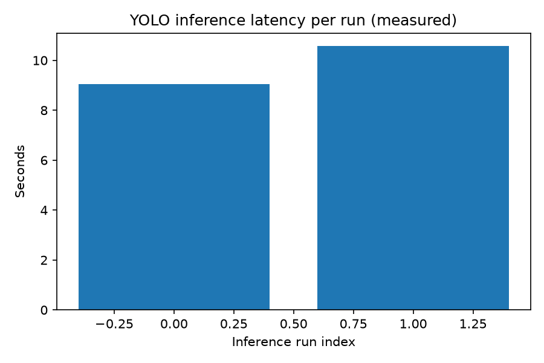
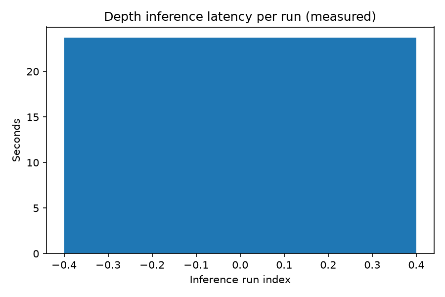
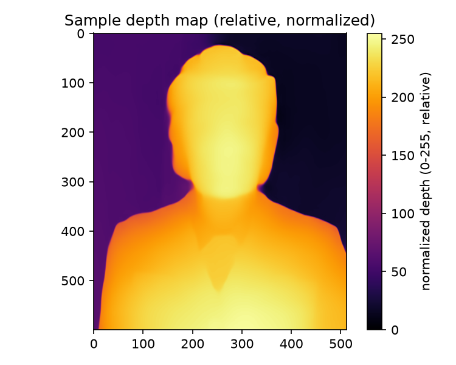
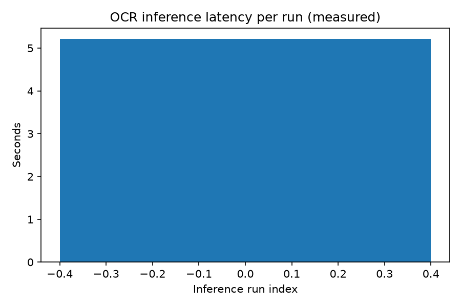
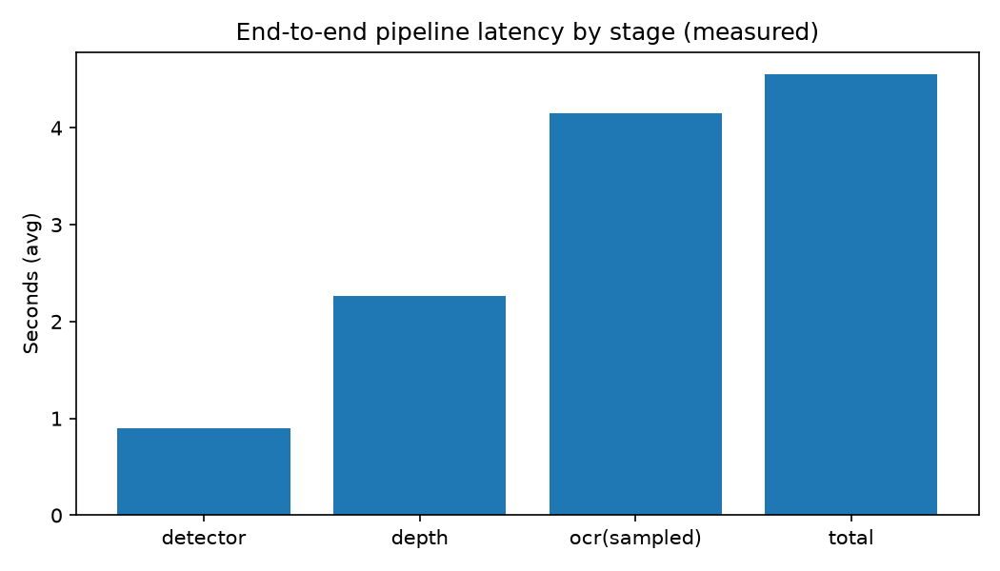
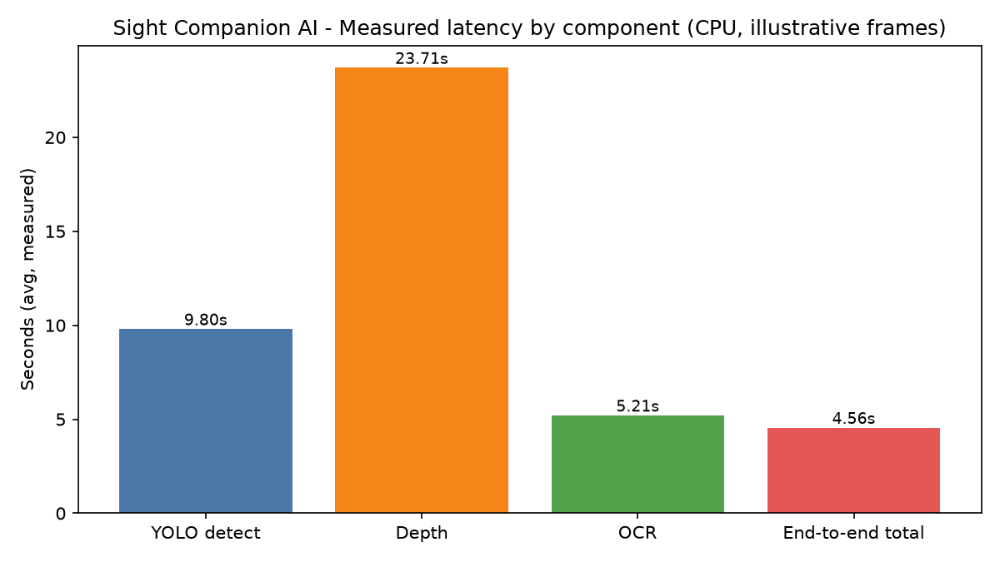

# Sight Companion AI Evaluation Report

**Project:** Sight Companion (FYP)  
**Report path:** `Sight_Companion_AI_Evaluation_Report.md` (project root)  
**Generated (UTC):** 2026-11-11T05:46:49Z (based on executed evaluation runs)  
**Evaluation scope:** Existing AI components in `Sight-companion-ai/` (no retraining, no production code/UI changes, no weight replacement)

---

## A. Executive Summary

### Purpose of the evaluation
To perform a comprehensive, reproducible, and academically defensible technical evaluation of the AI models currently used in Sight Companion (object detection, depth estimation, OCR) and the end-to-end AI pipeline performance, using the **existing implementations and pretrained weights**.

### AI components evaluated
| Component | Implementation | Model / Library | Primary role |
|---|---|---|---|
| Object Detection | `Sight-companion-ai/detector.py` | YOLOv8s (`yolov8s.pt`, Ultralytics, COCO 80-class) | Detect objects/obstacles and return labels, confidence, boxes |
| Depth Estimation | `Sight-companion-ai/depth.py` | Depth Anything Small (`LiheYoung/depth-anything-small-hf`, Transformers) | Produce **relative** depth map for proximity reasoning |
| OCR | `Sight-companion-ai/ocr.py` | EasyOCR (English) | Read visible text from frames |
| Pipeline integration | `navigation.py`, `video_processor.py`, `Backend/app.py` (inspected) | NavigationEngine + speech/camera orchestration | Convert detections/depth/OCR into prioritized instructions; backend streams/inference loop |

### Overall evaluation status
- **Executed (measured):** component/pipeline **latency, FPS, resource usage** (CPU/RAM sampling), functional smoke behavior, and a reproduced **4-word synthetic OCR micro-test** (preliminary only).
- **Pending / N/A (not legitimately computable):** **all ground-truth accuracy metrics** — detection mAP/precision/recall/F1/per-class/confusion/PR curves, depth MAE/RMSE/AbsRel/SqRel/LogRMSE/delta/threshold calibration, real-world OCR CER/WER/exact-match/category performance — because **no labeled/compatible ground-truth evaluation dataset** was found in the repository.
- **Not measured (requires live instrumentation):** camera-to-detection and detection-to-voice delays, and systematic condition-wise end-to-end behavior on live camera sessions.

### Most important findings
1. **No project ground-truth data exists** for detection, depth, or OCR (searched repo excluding `venv/`, `node_modules`, caches). Accuracy metrics cannot be fabricated; scripts/templates were created to enable proper evaluation once data is collected.
2. **Depth output is relative and per-frame normalized** to `uint8 [0,255]` (min-max each frame in `DepthEstimator.estimate`), not metric distance and not globally calibrated. Thresholds `VERY_CLOSE=179`, `CLOSE=115` are **heuristic/unvalidated** against measured distances.
3. **CPU-only environment (torch 2.15.0+cpu, no CUDA)** yields high latency on illustrative frames: detector ~**9.80 s/img (0.10 FPS)**, depth ~**23.71 s/img (0.04 FPS)**, OCR ~**5.21 s/img (0.19 FPS)**; 3-frame pipeline (OCR sampled every 3) averaged ~**4.56 s/frame (0.22 FPS)** with 0 processing failures in that run. (First-run/isolated-script measurements include model/runtime overhead; see methodology/limitations.)
4. **OCR synthetic micro-test reproduced**: 4/4 exact matches on clean rendered words (`EXIT, STOP, OPEN, CAFE`) — **preliminary functional check only**, not evidence of real-world OCR accuracy.

---

## B. Project and AI Model Overview

### Model inventory (inspected)
| Model | Architecture / Library | Pretrained weights / source | Input | Output | Existing evaluation data (in repo) |
|---|---|---|---|---|---|
| YOLOv8s | Ultralytics YOLOv8 (detect task, 80 COCO classes) | `Sight-companion-ai/yolov8s.pt` (22,588,772 bytes) | BGR frame (OpenCV) | List of `{name, confidence, box[x1,y1,x2,y2]}` | **None** (no labels/annotations/dataset) |
| Depth Anything Small | `AutoModelForDepthEstimation` (Transformers, HF) | `LiheYoung/depth-anything-small-hf` (downloaded/cached by HF at runtime) | BGR frame → resized to 320×240 for inference → depth upsampled to original H×W | **Relative** depth map, per-frame min-max normalized to `uint8 0–255` | **None** (no compatible metric GT / measured-distance labels) |
| EasyOCR | EasyOCR Reader | Default EasyOCR pretrained English recognition/detection models (library-managed) | BGR frame (converted to RGB) | List of `{text, confidence, box}` for conf ≥ threshold | **None** (no reference transcripts); 4-word synthetic micro-test reproducible as functional check only |

### Verified configurations (from source)
- `config.py`: `DEVICE=cuda if available else cpu`, `YOLO_MODEL_PATH="yolov8s.pt"`, `DEPTH_MODEL_NAME="LiheYoung/depth-anything-small-hf"`, `YOLO_CONF_THRESH=0.25`, `OCR_CONF_THRESH=0.45`, `VERY_CLOSE_THRESH=179`, `CLOSE_THRESH=115`, `COOLDOWN_SECONDS=3.0`, `CAMERA_SOURCE="auto"`.
- `detector.py`: `YOLO(model_path)`, inference `conf=config.YOLO_CONF_THRESH`, verbose off.
- `depth.py`: HF processor/model to `config.DEVICE`, inference downscale `DEPTH_INFER_SIZE=(320,240)`, bicubic upsample to original size, normalize `(x-min)/(max-min+ε)*255` → `uint8` per frame.
- `ocr.py`: `easyocr.Reader(['en'], gpu=(config.DEVICE=='cuda'))`, filters results by `OCR_CONF_THRESH`.
- `navigation.py`: zones left/ahead/right by thirds; depth level by mean box depth vs thresholds; cooldown-based speech suppression; text alerts only when no close/very-close hazards.
- `video_processor.py`: `DEPTH_EVERY=3`, OCR every `frame_skip` (default 5), auto camera detection (phone cam heuristics on Windows), threaded AI/display; `main.py` runs `PipelineProcessor(run_ocr=True)` with `source_path="auto"`.
- `Backend/app.py` (integration inspected): imports AI modules from `Sight-companion-ai/`, loads YOLO/depth/OCR, runs capture+inference loop, serves MJPEG/REST endpoints, persists OCR/detection-related data; OCR sampled (e.g. every 15 frames in backend loop) to save CPU.

### Preprocessing/postprocessing (key points)
- Detection: direct frame to Ultralytics; postprocess extracts class name/conf/xyxy.
- Depth: resize down for speed, RGB/PIL for HF, interpolate back, **per-frame min-max normalization** (destroys absolute scale and can reduce temporal consistency).
- OCR: BGR→RGB, EasyOCR `readtext`, confidence filtering.

---

## C. Evaluation Methodology

### Datasets used
| Dataset | Source | Ground truth | Used for |
|---|---|---|---|
| Illustrative sample image (1): `venv/.../matplotlib/mpl-data/sample_data/grace_hopper.jpg` | Matplotlib sample data present in environment | **None** (no detection boxes/labels, no metric depth, no transcript) | **Latency/functional smoke only** (not accuracy) |
| Custom detection dataset | `Sight-companion-ai/evaluation/dataset/detection/` (images/labels + `data.yaml`) | **Not present** | mAP/PR/Recall/F1/confusion/PR — **pending** |
| Custom depth dataset | `Sight-companion-ai/evaluation/dataset/depth/` (images/ground_truth) | **Not present/empty** | MAE/RMSE/AbsRel/SqRel/LogRMSE/deltas, threshold calibration — **pending** |
| Custom OCR dataset | `Sight-companion-ai/evaluation/dataset/ocr/` (images/transcripts) | **Not present** | CER/WER/exact-match/category performance — **pending** |
| Synthetic OCR micro-test (4 words) | Generated in-script (clean rendered `EXIT/STOP/OPEN/CAFE`) | Known rendered strings | **Preliminary functional reproduction only** (not real-world accuracy) |

### Ground-truth formats (templates provided)
- **Detection:** YOLO `.txt` labels per image + Ultralytics `data.yaml`.
- **Depth:** aligned metric depth maps (e.g. `.npy`, meters, same H×W/mask) or measured-distance manifest for threshold calibration; compatible representation required (do not compare normalized relative values to metric distances).
- **OCR:** per-image `.txt` transcript (same stem) or `transcripts/manifest.csv` (`image,reference,category`).

### Evaluation procedures (executed scripts)
All scripts in `Sight-companion-ai/evaluation/`, reusing existing model classes/weights, saving CSV/JSON/plots, recording environment/config. No predictions used as ground truth; no fabricated metrics.

| Script | What it measured | Ground-truth metrics computed |
|---|---|---|
| `evaluate_detector.py` | Inference latency/FPS, detections count (illustrative image) | **No** — no labels/data.yaml → mAP/PR/Recall/F1 pending |
| `evaluate_depth.py` | Inference latency/FPS, output shape/range/stats, representation & threshold documentation | **No** — no compatible metric GT → depth errors/deltas pending |
| `evaluate_ocr.py` | Inference latency/FPS, avg confidence, detection success, reproduced synthetic micro-test | **No** — no transcripts → CER/WER/exact-match (real) pending |
| `evaluate_end_to_end.py` | Per-stage & total pipeline latency/FPS, psutil CPU/RAM sampling, failures/empty outputs (3 static frames, OCR every 3) | **No** — no end-to-end GT annotations |

### Test environment (recorded)
- **OS/host:** Windows-11-10.0.22000-SP0, AMD64, Intel64 Family 6 Model 186 Stepping 3 (12 logical / 10 physical cores), ~7.64 GB RAM
- **Python:** 3.13.14
- **Key packages:** opencv-python 5.0.0, numpy 2.5.4, torch 2.15.0+cpu (**CUDA unavailable**), ultralytics 8.4.202, easyocr 1.7.2, transformers 5.22.1, matplotlib 3.11.2, psutil 7.2.2
- **Execution:** CPU-only; illustrative/sample frames (no camera capture in these runs)

---

## D. Object Detection Results (YOLOv8)

**Model (verified):** YOLOv8s, weights `Sight-companion-ai/yolov8s.pt`, conf 0.25, COCO 80 classes. Pretrained model evaluated as-is (no retraining).

### Ground-truth accuracy metrics
| Metric | Actual result | Status | Reason |
|---|---|---|---|
| Precision | N/A | Pending | No labeled detection annotations/dataset (`data.yaml` + `labels/`) |
| Recall | N/A | Pending | Same |
| F1-score | N/A | Pending | Same |
| mAP@0.5 | N/A | Pending | Same |
| mAP@0.5:0.95 | N/A | Pending | Same |
| Per-class precision/recall | N/A | Pending | Same |
| Confusion matrix | Not generated | Pending | Requires labeled dataset |
| Precision-recall curves | Not generated | Pending | Requires labeled dataset |

**COCO benchmark performance:** Not re-measured on COCO in this environment (no COCO val set downloaded/configured; large download not performed without approval). Published Ultralytics/COCO benchmarks for YOLOv8s are **external reference values** and must **not** be treated as measured Sight Companion performance.

**Custom Sight Companion dataset performance:** None (no custom labeled dataset found).

### Measured performance (functional/latency, illustrative sample — NOT accuracy)
- Images evaluated: **1** (`grace_hopper.jpg`, illustrative, no GT), repeats 2 + warmup 1
- Detections: **2** (`person:0.896`, `tie:0.326`)
- Avg inference: **9.803548 s/image**
- FPS: **0.102**



**Data:** `Sight-companion-ai/evaluation/results/detection_results.csv`, `detection_results.json`

---

## E. Depth Estimation Results (Depth Anything Small)

**Model (verified):** `LiheYoung/depth-anything-small-hf`, infer size 320×240 (W×H) then upsampled.  
**Critical representation:** **Relative, inverse-like depth normalized per frame to `uint8 0–255`** (`(x-min)/(max-min+ε)*255`). **Not metric distance.** A value of 190 does **not** mean 190 cm. Per-frame normalization can change values for the same real distance across frames/scenes.

**Thresholds (config):** Very Close ≥ 179, Close ≥ 115, else Far. **Experimentally validated:** **No** (heuristic/unvalidated; no measured-distance samples found).

### Ground-truth / metric accuracy
| Metric | Actual result | Status | Reason |
|---|---|---|---|
| MAE | N/A | Pending | No compatible metric ground-truth depth (aligned, same representation/units/mask/protocol) |
| RMSE | N/A | Pending | Same |
| AbsRel | N/A | Pending | Same |
| SqRel | N/A | Pending | Same |
| Log RMSE | N/A | Pending | Same |
| Delta < 1.25 | N/A | Pending | Same |
| Delta < 1.25² | N/A | Pending | Same |
| Delta < 1.25³ | N/A | Pending | Same |
| Calibration (relative→metric) | Not performed | Pending | No measured-distance reference data |
| Threshold classification vs measured distance | N/A | Pending | No labeled distance samples |

### Measured performance & output sanity (illustrative sample — NOT accuracy)
- Images evaluated: **1** (illustrative, no GT)
- Output: shape **(600, 512)**, dtype **uint8**, min 0, max 255, mean ~130.18
- Avg inference: **23.706029 s/image**
- FPS: **0.042**
- Consistency note: per-frame normalization means temporal consistency is not guaranteed without calibration/global scaling (single-frame std proxy N/A).





**Data:** `Sight-companion-ai/evaluation/results/depth_results.csv`, `depth_results.json`

---

## F. OCR Results (EasyOCR)

**Model (verified):** EasyOCR Reader `['en']`, `gpu=False` on this host (CPU), `OCR_CONF_THRESH=0.45`.

### Ground-truth accuracy metrics (real/custom data)
| Metric | Actual result | Status | Reason |
|---|---|---|---|
| CER | N/A | Pending | No reference transcripts/ground truth for custom/real images |
| WER | N/A | Pending | Same |
| Exact-match accuracy (real) | N/A | Pending | Same |
| Text detection success rate (GT-based) | N/A | Pending | No bounding-box/text GT dataset |
| Category-wise (clean/blur/low-light/tilted/distant) | N/A | Pending | Insufficient/no labeled samples per category |

### Reproduced synthetic micro-test (preliminary functional check only)
- Cases: **4** clean rendered words (`EXIT`, `STOP`, `OPEN`, `CAFE`)
- Exact-match (case-insensitive): **1.0 (4/4)** (recognized with ~0.999 conf in run)
- **Not sufficient** to claim real-world OCR accuracy.

### Measured performance (illustrative sample — NOT accuracy)
- Images evaluated: **1** (illustrative, no GT)
- Avg inference: **5.210918 s/image**
- FPS: **0.192**
- Average OCR confidence (detected items): **0.0** (no text detected above threshold on that image)
- Text detection success rate (non-empty output): **0.0** for that sample



**Data:** `Sight-companion-ai/evaluation/results/ocr_results.csv`, `ocr_results.json`

---

## G. End-to-End System Performance

**Pipeline evaluated:** detector → depth (every frame in script) → OCR (sampled every 3 frames) → `NavigationEngine.evaluate` on **3 static illustrative frames** (same components/classes as AI modules; no live camera I/O, no live TTS audio timing). This is a **performance/reliability measurement**, not accuracy.

| Parameter | Actual result | Notes |
|---|---|---|
| Frames evaluated | 3 | `illustrative_sample_no_gt` |
| Avg detector latency | 0.903240 s/frame | component avg (end-to-end run) |
| Avg depth latency | 2.267478 s/frame |  |
| Avg OCR latency (sampled frames) | 4.148435 s (when run) | OCR run every 3 frames |
| Avg navigation latency | 0.004064 s/frame |  |
| **Total processing latency (avg)** | **4.557605 s/frame** | pipeline stages per evaluated frame |
| **Pipeline FPS (avg)** | **0.219** | 1 / total avg latency |
| CPU usage (process-sampled avg) | **83.63%** | psutil in-process samples; depends on host load |
| RAM (process RSS avg) | **420.04 MB** | includes loaded models/components in run |
| Processing failures | **0** | in this run |
| Empty output frames | **0** | (detections/instructions present in sampled frames) |
| Model load times | detector 0.334 s, depth 1.876 s, OCR 4.612 s | cold-ish in-script loads |





**Not measured (requires live run):**
- Camera-to-detection delay: **NOT_MEASURED** (needs live capture timestamps).
- Detection-to-voice-announcement delay: **NOT_MEASURED** (needs TTS/audio instrumentation; async speech engine).

**Behavior (code-inspected / partially observed):** cooldown-based suppression for repeated announcements; no persistent cross-frame tracker IDs; OCR and expensive stages sampled/throttled in pipeline/backend; condition-specific robustness (poor light, blur, motion, empty frames) **not systematically measured** without labeled/controlled media.

**Data:** `Sight-companion-ai/evaluation/results/end_to_end_results.csv`, `end_to_end_results.json`, `evaluation_summary.json`

---

## H. Visual Results

Generated plots (relative paths):
- `Sight-companion-ai/evaluation/plots/detection_latency.png` — YOLO inference latency per run (measured)
- `Sight-companion-ai/evaluation/plots/depth_latency.png` — Depth inference latency per run (measured)
- `Sight-companion-ai/evaluation/plots/depth_sample_map.png` — Sample **relative, normalized** depth map
- `Sight-companion-ai/evaluation/plots/ocr_latency.png` — OCR inference latency per run (measured)
- `Sight-companion-ai/evaluation/plots/end_to_end_latency.png` — Pipeline latency by stage (measured)
- `Sight-companion-ai/evaluation/plots/evaluation_comparison.png` — Component/pipeline latency comparison (measured)

No confusion matrix or PR curves were generated because **no labeled detection dataset** is available.

---

## I. Limitations

1. **Missing ground-truth datasets:** No annotations for detection (boxes/classes), no compatible metric depth GT or measured-distance labels, no OCR transcripts — **accuracy metrics (mAP, PR, recall, F1, MAE/RMSE/AbsRel/SqRel/LogRMSE/deltas, CER/WER/real exact-match) cannot be computed legitimately.**
2. **Insufficient sample sizes:** Performance measurements used 1 illustrative image (per-component scripts) and 3 static frames (end-to-end); results are **not statistically representative** of real-world usage.
3. **Uncalibrated depth:** Output is relative and per-frame min-max normalized (0–255). Thresholds (179/115) are **heuristic, not experimentally validated**; cannot be interpreted as physical distances.
4. **Environment/hardware:** CPU-only, Windows host, no CUDA; latency/FPS will differ substantially on GPU/mobile/other CPUs. Measurements include script/runtime overhead and vary with load/caching.
5. **Scope gaps:** No live camera capture timing, no live TTS-to-audio delay measurement, no condition-specific (lighting/motion/blur) benchmark, no category-wise OCR breakdown (insufficient labeled data), no COCO/custom val run for detection metrics.
6. **External benchmarks not measured:** COCO benchmark numbers for YOLOv8s were not reproduced here; if cited elsewhere they are external references, not Sight Companion measurements.

---

## J. Recommendations

1. **Detection:** Collect and annotate a Sight Companion–specific image/video-frame dataset (YOLO format) covering target hazards/objects, lighting, and camera angles; create `dataset/detection/data.yaml` and run `evaluate_detector.py` to obtain real mAP/PR/Recall/F1/confusion/PR curves. Consider per-class analysis for safety-critical classes.
2. **Depth:** (a) Record images at **known measured distances** with documented protocol to calibrate/validate Very Close/Close/Far thresholds; (b) if metric evaluation is required, use a dataset with compatible metric depth GT (aligned, masked, same protocol) or a model/configuration that provides metric depth; (c) reduce per-frame normalization effects for temporal stability (e.g. consistent scaling/calibration) and re-evaluate.
3. **OCR:** Build a labeled set of real camera-captured sign/text images with manually verified transcripts and categories (clean/blur/low-light/tilted/distant); compute CER/WER/exact-match and detection success; keep normalization transparent.
4. **End-to-end:** Instrument live runs to measure camera-to-detection and detection-to-voice latency; benchmark on representative video streams and devices; track reliability under stress conditions (multiple objects, occlusion, motion, empty frames).
5. **Performance:** GPU acceleration (CUDA-capable PyTorch) and/or lighter models/quantization can reduce latency; validate accuracy trade-offs on labeled data before deployment.
6. **Academic reporting:** Always separate **measured project results**, **preliminary functional checks**, and **external published benchmarks**; report sample sizes, hardware, and confidence/limitations.

---

## K. Final Evaluation Summary

| AI Component | Evaluation Parameter | Actual Result | Status |
|---|---|---|---|
| YOLO | Precision | N/A | Pending (no ground-truth annotations) |
| YOLO | Recall | N/A | Pending (no ground-truth annotations) |
| YOLO | F1-score | N/A | Pending (no ground-truth annotations) |
| YOLO | mAP@0.5 | N/A | Pending (no labeled dataset/data.yaml) |
| YOLO | mAP@0.5:0.95 | N/A | Pending (no labeled dataset/data.yaml) |
| Depth | MAE | N/A | Pending (no compatible metric ground truth) |
| Depth | RMSE | N/A | Pending (no compatible metric ground truth) |
| Depth | AbsRel | N/A | Pending (no compatible metric ground truth) |
| OCR | CER | N/A | Pending (no reference transcripts) |
| OCR | WER | N/A | Pending (no reference transcripts) |
| OCR | Exact-match accuracy | N/A (real GT); synthetic micro-test 1.0 on 4 clean words (preliminary, not real-world) | Pending / Preliminary functional check only |
| System | FPS | 0.219 (avg pipeline, 3 static frames, CPU) | Evaluated (performance, not accuracy) |
| System | Latency | 4.558 s/frame avg total pipeline (CPU, illustrative frames) | Evaluated (performance, not accuracy) |

**Additional measured (supporting):** YOLO latency 9.804 s/img (0.102 FPS), Depth 23.706 s/img (0.042 FPS), OCR 5.211 s/img (0.192 FPS, avg conf 0.0 on sample), CPU avg 83.63%, RSS avg 420.04 MB, processing failures 0 (measured run). **End-to-end accuracy:** N/A (no GT). **Live camera→detection / detection→voice delays:** NOT_MEASURED.

---

## Reproducibility: evaluation artifacts

- Scripts: `Sight-companion-ai/evaluation/evaluate_detector.py`, `evaluate_depth.py`, `evaluate_ocr.py`, `evaluate_end_to_end.py`, `eval_common.py`
- Datasets/templates: `Sight-companion-ai/evaluation/dataset/{detection,depth,ocr}/`
- Machine-readable results: `Sight-companion-ai/evaluation/results/{detection,depth,ocr,end_to_end}_results.{csv,json}`, `evaluation_summary.json`
- Plots: `Sight-companion-ai/evaluation/plots/*.png`
- Documentation: `Sight-companion-ai/evaluation/README.md`

**Rerun (PowerShell, project root):**
```powershell
cd D:\Sight_Companion
$env:PYTHONPATH = "D:\Sight_Companion\Sight-companion-ai"
.\venv\Scripts\python.exe Sight-companion-ai\evaluation\evaluate_detector.py
.\venv\Scripts\python.exe Sight-companion-ai\evaluation\evaluate_depth.py
.\venv\Scripts\python.exe Sight-companion-ai\evaluation\evaluate_ocr.py
.\venv\Scripts\python.exe Sight-companion-ai\evaluation\evaluate_end_to_end.py
```

*No production application files, UI, configs, or pretrained weights were modified for this evaluation; evaluation assets are isolated under `Sight-companion-ai/evaluation/` and this root report.*
